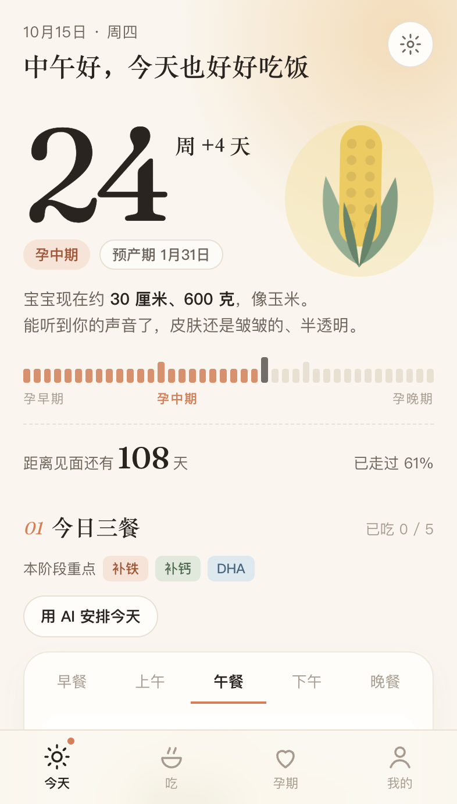
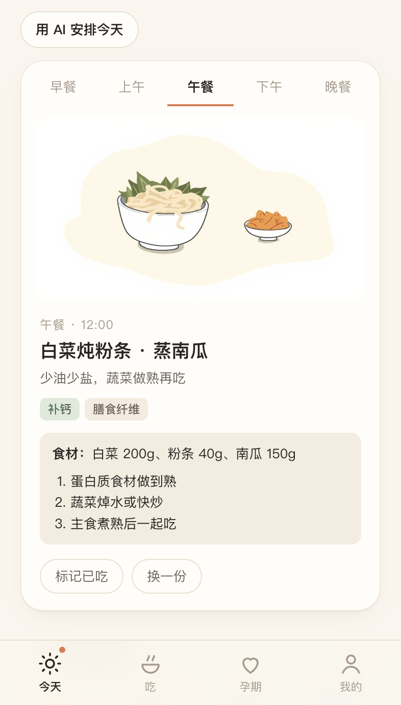
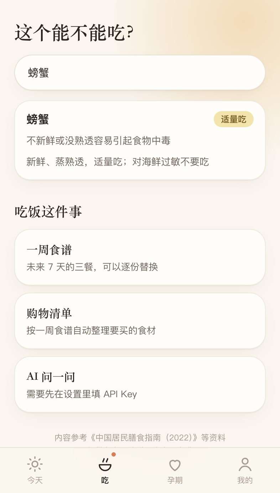
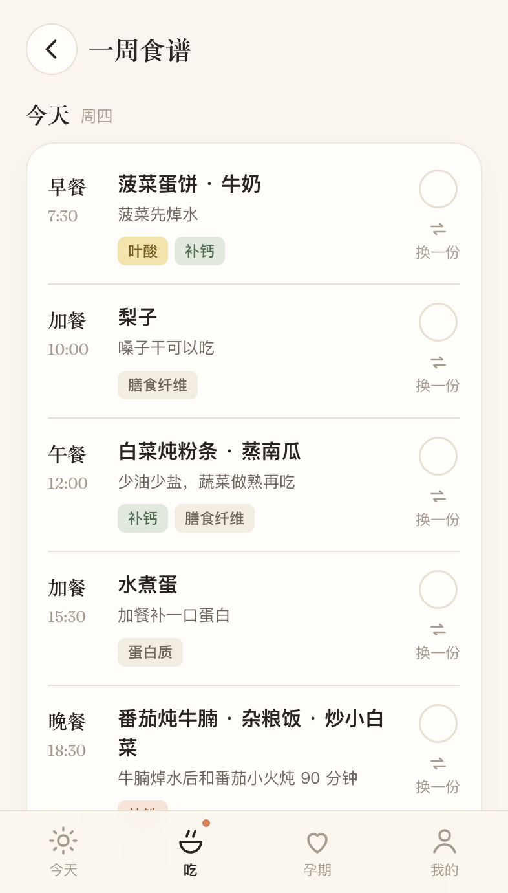
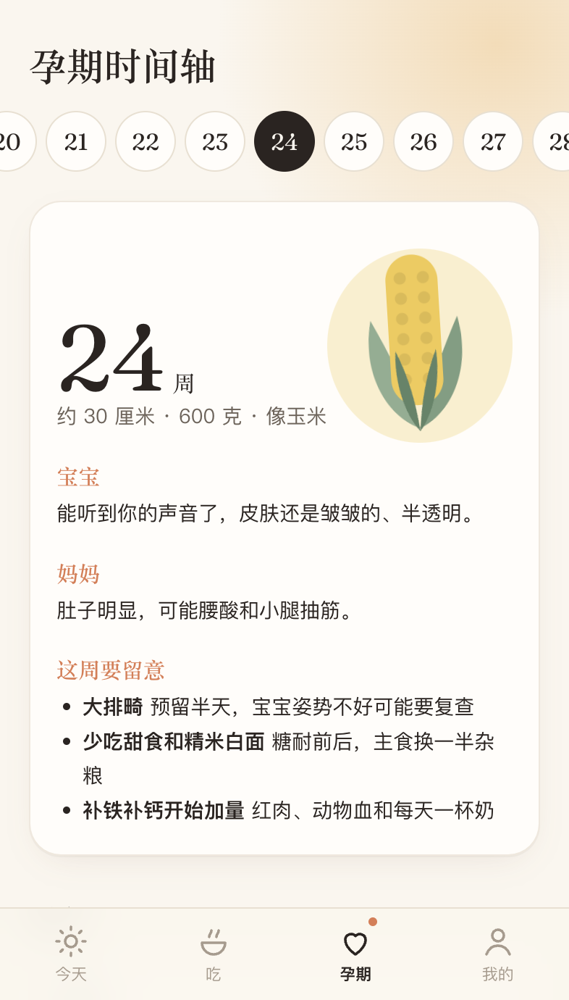
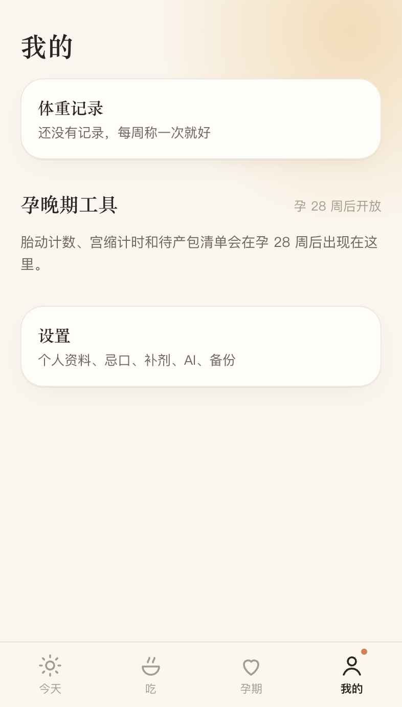
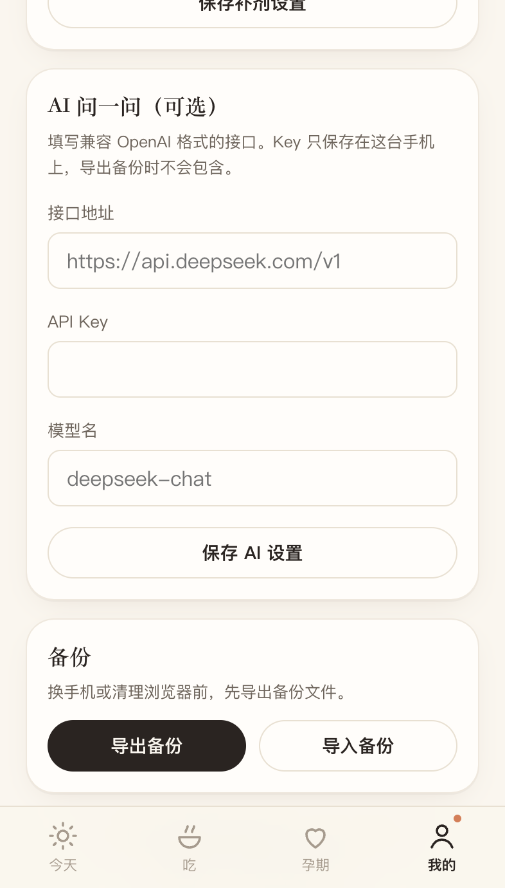

# 孕期小伴

每天吃什么、补什么、什么时候产检。这是一个可以加到手机桌面的网页应用，记录都保存在这台手机里。

内容参考《中国居民膳食指南（2022）》等资料，仅供参考，请以医生意见为准。

底部有四个入口：**今天**、**吃**、**孕期**、**我的**。

## 今天

打开就能看到孕周、宝宝大小、距离预产期还有多久。往下是今天的五餐、补剂打卡，以及下一次产检。



五餐用标签切换：早餐、上午、午餐、下午、晚餐。每餐有配图、食材和做法。吃过了点「标记已吃」，不喜欢可以「换一份」。



「让 AI 安排今天」会按孕周和忌口重排五餐，并给这几餐画配图。想回到原来的推荐，点「恢复系统推荐」。过了当天，这些 AI 配图会自动删掉，菜名和做法还留着。

## 吃

搜一种食物，看能不能吃、为什么、怎么吃。收录里没有的，填好 API Key 之后可以问 AI，回答和收录卡片用同一种格式。



这里还能打开：

- **一周食谱**：未来 7 天的三餐，每一份都可以换。
- **购物清单**：按这一周的菜，整理要买的食材。
- **AI 问一问**：有具体问题就直接问。



## 孕期

时间轴按孕周看宝宝和妈妈的变化。点上面的周数可以看其他周。



往下还有三页：

- **胎教**：这一周适合做什么，以及哪些说法没有依据。
- **产检日程**：全部产检，可以改日期。点「加入日历」会下载日程文件，用手机日历打开后，由系统提醒。
- **危险信号**：哪些情况要马上就医。

## 我的

记体重。孕 28 周之后，这里会多出数胎动、宫缩计时和待产包。



设置里可以改预产期和忌口、选择要显示的补剂、填写 AI 接口，也可以导出或导入备份。换手机或清理浏览器之前，先导出备份。备份文件里不含 API Key。



## 在电脑上运行

需要 Node.js 20 或更新版本，以及 pnpm。

```bash
pnpm install
pnpm dev
```

浏览器打开 http://127.0.0.1:5173 。第一次会先填写预产期、身高和孕前体重。

### 食谱配图

内置食谱的配图已经放在 `public/meal-images/`。要重新生成时，把 MiniMax 的密钥单独写进 `scripts/minimax.local`（只写一行，不要加引号，不要提交这个文件），然后运行：

```bash
pnpm meals:images
```

已有的图片会跳过。某一张要重画：`pnpm meals:images -- --id r108 --force`。

### AI

在「我的 → 设置」里填写兼容 OpenAI 格式的接口地址、API Key 和模型名。Key 只存在这台手机上。

让 AI 安排今天之后，配图用设置里的同一个接口地址和 API Key，请求 `/image_generation`。密钥留在这台手机上，打包部署之后也能画。

## 部署

这是静态网站，构建结果在 `dist/`。

```bash
pnpm install
pnpm test
pnpm build
```

`public/_redirects` 会在刷新子页面时回到首页，避免直接打开 `/eat` 这类地址时出现 404。

### Cloudflare Pages

第一次部署会在浏览器里登录 Cloudflare：

```bash
pnpm dlx wrangler pages deploy dist --project-name yunqi-xiaoban
```

完成后会给出一个 `https://yunqi-xiaoban.pages.dev` 这样的地址。

用 Git 连接 Cloudflare Pages 时，构建命令填 `pnpm build`，输出目录填 `dist`。不需要把 API Key 配到服务器上，每人在自己的手机里填写。

### 其他静态托管

把 `dist/` 里的文件放到网站根目录。服务器要把找不到的路径回退到 `index.html`，例如 Nginx：

```nginx
location / {
  try_files $uri $uri/ /index.html;
}
```

网站需要 HTTPS，手机才能把它加到桌面。

- iPhone：用 Safari 打开，点分享，再点「添加到主屏幕」。
- Android：用 Chrome 打开，在菜单里安装应用。

加到桌面之后，没网也能看已经打开过的页面。产检提醒靠日历里的日程，应用自己不会在后台推送。记录存在浏览器里，换域名或清除网站数据会丢掉，换手机前先在设置里导出备份。
